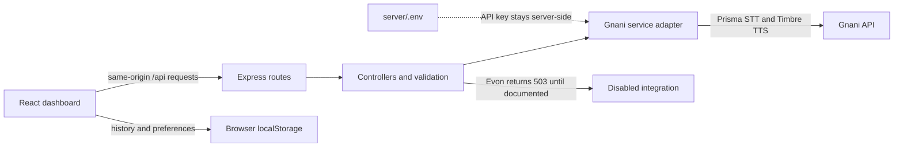

# VoiceMate AI

VoiceMate AI is a responsive voice assistant dashboard built for the **Gnani AI Great Indian AI Internship Challenge**. It connects microphone input to Gnani Prisma speech recognition and sends message text to Gnani Timbre for spoken playback. The chat screen is honest about the current scope: Gnani Evon has not been enabled, so chat requests return a clear unavailable response instead of a fabricated answer.

## Problem statement

Typing is not always the easiest way to capture a thought or interact with an assistant. VoiceMate provides a single interface for speaking a short message, reviewing the speech recognition result, and listening to text through speech synthesis. It also makes service availability and integration limits visible.

## Features

- Responsive assistant dashboard with dark and light appearance settings.
- Microphone capture with permission handling, a recording indicator, and a 30-second cap.
- Browser-side audio conversion to mono PCM WAV for Prisma.
- Actual Prisma transcript displayed as a conversation message with a transcription label.
- Text-to-speech playback action on conversation messages using Timbre.
- Playback, transcription, connection, loading, and error states.
- Conversation list and history stored in browser `localStorage`.
- Backend-only Gnani API key handling.
- Evon chat remains disabled until its official API contract is confirmed.

## Gnani integrations

### Prisma speech-to-text

The browser records audio, converts it to a WAV file, and uploads it to the app’s `POST /api/speech-to-text` route. Express validates and passes the file to Prisma using the documented REST request: multipart `audio_file`, `model`, and `language_code` fields plus the server-side `X-API-Key-ID` header. Voice capture is limited to 30 seconds, matching the documented short-clip endpoint.

The transcript returned by Prisma is shown directly in the conversation and is not submitted to Evon automatically. Prisma configuration is set with `GNANI_PRISMA_MODEL` and `GNANI_STT_LANGUAGE`.

### Timbre text-to-speech

The message **Listen** action calls `POST /api/text-to-speech`. Express sends the documented JSON request to Timbre with the configured model, voice, language, and WAV audio settings. The service returns binary WAV audio; the app API encodes it for the browser, which creates a playable audio object. Timbre configuration is set with `GNANI_TIMBRE_MODEL`, `GNANI_TTS_VOICE`, and `GNANI_TTS_LANGUAGE`.

Choose a voice and language pairing from Gnani’s [official voice catalog](https://docs.gnani.ai/api/TTS/available-voices). For example, `Shlok` is listed for English (`en-IN`); `Nalini` is listed for Hindi (`hi-IN`). A mismatched language may reduce voice quality.

### AI reasoning status and limitations

Evon is **not configured or claimed as working**. `POST /api/chat` returns HTTP `503` until its official endpoint, authentication, request format, and response format are confirmed and implemented. The project does not use a mock or hardcoded answer as a substitute. The `GNANI_EVON_ENDPOINT` variable is a placeholder only.

## Technology stack

- **Frontend:** React 18, Vite 6, Lucide icons, modern CSS
- **Backend:** Node.js, Express 4, Multer 2, dotenv, CORS
- **Speech services:** Gnani Prisma REST and Gnani Timbre REST
- **Persistence:** Browser `localStorage` for conversation history and preferences
- **Database:** MongoDB is not connected in this implementation
- **Tests:** Node.js built-in test runner; Gnani upstream calls are mocked

## Architecture



The Vite development server proxies `/api` to Express. The frontend has no API key or direct Gnani credential configuration. `GET /api/health` reports whether an API key is present for the configured speech services; it does not validate the key’s scope or make a live upstream request.

## Installation

Requirements: Node.js 20 or newer and npm.

From the project root:

```sh
npm install
npm install --prefix client
npm install --prefix server
```

Copy `.env.example` to `server/.env` if that file does not already exist. If `server/.env` already exists, edit it in place and keep the secret value private; do not overwrite or commit it.

## Environment configuration

Set these values in `server/.env` only:

```dotenv
PORT=4000
CLIENT_ORIGIN=http://localhost:5173

GNANI_API_KEY=your-server-side-key
GNANI_API_BASE_URL=https://api.vachana.ai

GNANI_PRISMA_MODEL=prisma-v3.0
GNANI_STT_LANGUAGE=indic-auto

GNANI_TIMBRE_MODEL=timbre-v2.5
GNANI_TTS_VOICE=Shlok
GNANI_TTS_LANGUAGE=en-IN

GNANI_EVON_ENDPOINT=
```

Never place `GNANI_API_KEY` in `client/`, a `VITE_*` variable, source code, screenshots, or a public issue. The example uses an English Timbre voice/language pairing; set a different compatible pair if needed. Do not fill in the Evon placeholder until official documentation is confirmed.

## Run the application

Start the Express API and Vite frontend together:

```sh
npm run dev
```

- Dashboard: <http://localhost:5173>
- Backend health: <http://localhost:4000/api/health>

Run one process separately with `npm run dev:client` or `npm run dev:server`. Browser microphone access is available on localhost; grant permission when prompted.

## App API endpoints

| Method | Path | Request | Behavior |
| --- | --- | --- | --- |
| `GET` | `/api/health` | — | Returns API status and configured service flags. Flags indicate key presence, not a verified upstream call. |
| `POST` | `/api/chat` | JSON `{ "message": "...", "conversationId": "..." }` | Returns `503` while Evon is disabled. |
| `POST` | `/api/speech-to-text` | Multipart field `audio` | Sends a WAV recording to Prisma and returns `{ "text": "..." }`. |
| `POST` | `/api/text-to-speech` | JSON `{ "text": "...", "voice": "..." }` | Sends text to Timbre and returns `{ "audioBase64": "...", "mimeType": "audio/wav" }`. The configured backend voice is used. |
| `POST` | `/api/speech-to-text/synthesize` | Same JSON body as TTS | Existing compatibility alias for synthesis. |

Routes validate missing inputs and size limits. Upstream failures return an error message and status rather than a fake success result.

## Testing and checks

```sh
npm test
npm run check:server
npm run build
npm audit
npm audit --prefix client
npm audit --prefix server
```

The integration tests mock `fetch` and use a test-only key to verify Prisma multipart fields, Timbre JSON/audio handling, upstream error handling, and disabled Evon behavior. They do **not** make real Gnani API calls or prove that the configured key has working credentials/scopes. A live speech test should be run manually with a short recording and should be treated as audio sent to Gnani.

## Screenshots

No screenshots have been captured or included yet. See the [screenshot plan](docs/screenshot-plan.md) for suggested frames and captions. Add approved, secret-free images under `docs/screenshots/` before linking them here.

## Demo materials

- [Two-minute demo script](docs/demo-video-script.md)
- [Recording checklist](docs/recording-checklist.md)
- [LinkedIn launch post draft](docs/linkedin-launch-post.md)
- [Screenshot plan](docs/screenshot-plan.md)

## Future improvements

- Confirm and implement Evon only from its official API documentation.
- Add persistent, authenticated conversation storage if the product needs cross-device history.
- Add explicit playback controls and configurable voices after checking supported model/voice combinations.
- Add user-visible privacy and retention controls before broader deployment.
- Add browser-level UI tests and controlled live API smoke tests that do not expose credentials.

## Public repository readiness

The project currently has no Git repository metadata and no configured remote. `.gitignore` excludes environment files, dependency folders, build output, logs, and local certificates. Review the working tree and ensure `server/.env` is absent from the initial commit before creating a public repository. Nothing is pushed or published by this project setup.
